# ha-guest-card

[](https://www.home-assistant.io/integrations/marketplace/)
[](https://github.com/juju35/ha-guest-card/actions/workflows/hacs.yml)
[](https://github.com/juju35/ha-guest-card/actions/workflows/validate.yml)
[](https://github.com/juju35/ha-guest-card/actions/workflows/lint.yml)
[](https://github.com/juju35/ha-guest-card/releases/latest)
[](https://github.com/juju35/ha-guest-card/blob/main/LICENSE)
[](https://buymeacoffee.com/julienstep9)

<p align="center"></p>

<p align="center">
  <a href="https://www.home-assistant.io/"></a>&nbsp;&nbsp;
  <a href="https://github.com/nielsfaber/alarmo"></a>&nbsp;&nbsp;
  <a href="https://www.home-assistant.io/integrations/yale/"></a>&nbsp;&nbsp;
  <a href="https://www.home-assistant.io/integrations/nuki/"></a>&nbsp;&nbsp;
  <a href="https://www.home-assistant.io/integrations/google/"></a>&nbsp;&nbsp;
  <a href="https://www.home-assistant.io/integrations/caldav/"></a>
</p>

A Lovelace card for **guests and babysitters**: the guest Wi-Fi as a QR code to scan, the door code and the password behind a button, the front door and the alarm, the evening's plan and who to call — under a guest mode you switch on and off from the card.

[](https://my.home-assistant.io/redirect/marketplace_repository/?owner=juju35&repository=ha-guest-card&category=plugin)

| Card | Type | What it shows |
|---|---|---|
| [Guest](#screenshots) | `custom:guest-card` | The guest Wi-Fi QR code, the door code, the lock and the alarm, the evening and the contacts, with the guest mode switch. |
| [Guest mini](#guest-mini) | `custom:guest-mini-card` | Guest mode and the network on two lines, the QR code one tap away, with a zoom to the full card. |

| Guest mode on | By night, ending soon |
|---|---|
| 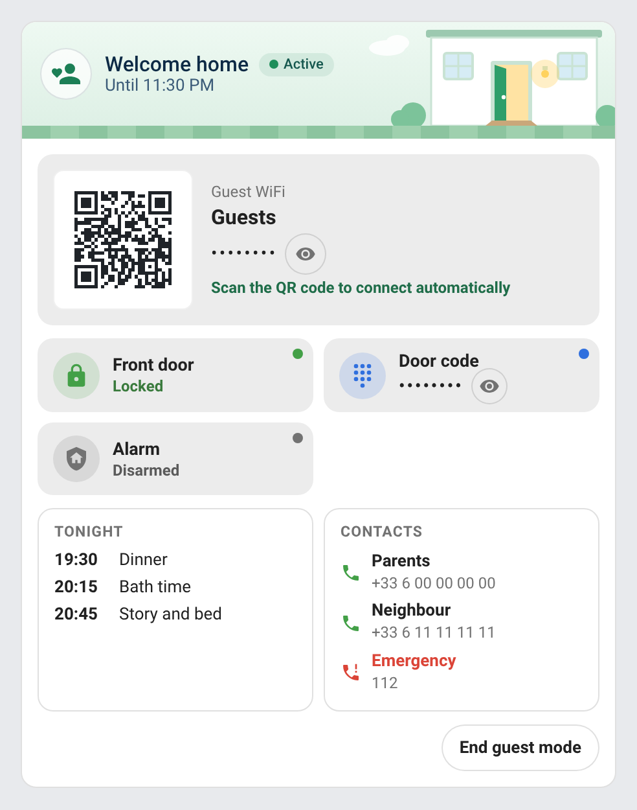 | 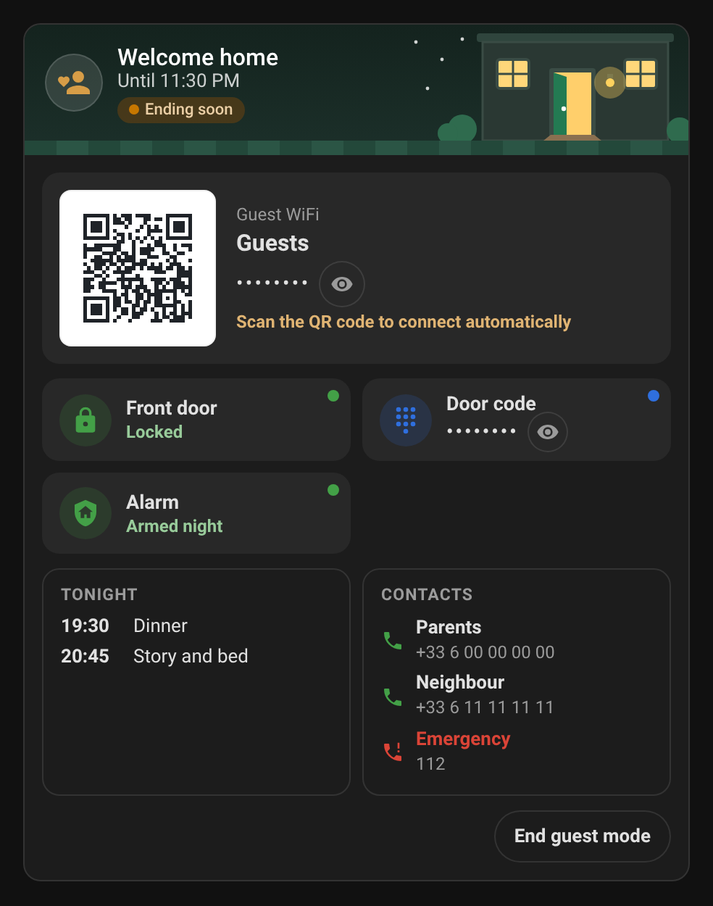 |

## Features

- **Guest Wi-Fi QR code**: phones join the network by scanning it; a tap opens it **full screen**, centred on the screen (Escape or a tap closes it). WPA / WPA2 / WPA3, WEP, open and hidden networks; the network name and the password can come from entities
- **Secrets behind a button**: the Wi-Fi password and the door code are masked; shown, they are masked again after 30 seconds and when the card leaves the page
- **Tiles** for the front door lock and the alarm (any `lock` and `alarm_control_panel` integration, Alarmo included), in their state's colour, a tap opening their details
- **Tonight**: the evening's plan — a list written in the card, and a calendar's events from now to the end of the evening
- **Contacts**: names and numbers as phone links, and the emergency number (112 by default)
- **Guest mode**: an `input_boolean` (or a switch) turns it on and off, with an optional end time — a time or a date / time entity; the status turns amber in its last 30 minutes, and the card's button ends or starts it
- **Illustrated header**: a house whose door opens with guest mode, a porch light that breathes and bushes that sway; by night (the dark theme) stars come out and the windows are lit
- **Mini card**: the title and the state, then the network — a tap shows its QR code full screen; its zoom button opens the full card in place
- Visual editor for both cards, light and dark themes, 22 languages, no external dependency (the QR code is drawn by the card)

## Supported integrations

The card works on top of Home Assistant entities, whatever their integration. Among them:

| | Integration | What the cards show |
|:---:|---|---|
|  | [Input boolean](https://www.home-assistant.io/integrations/input_boolean/) / [Input text](https://www.home-assistant.io/integrations/input_text/) / [Input datetime](https://www.home-assistant.io/integrations/input_datetime/) (built in) | The guest mode switch, the network name and password, the end time |
|  | [Alarmo](https://github.com/nielsfaber/alarmo) (Marketplace) | The alarm's state (any `alarm_control_panel`) |
|  | [Yale](https://www.home-assistant.io/integrations/yale/) (built in) | The front door lock (any `lock`) |
|  | [Nuki](https://www.home-assistant.io/integrations/nuki/) (built in) | The front door lock (any `lock`) |
|  | [Local Calendar](https://www.home-assistant.io/integrations/local_calendar/) (built in) | The evening's events |
|  | [Google Calendar](https://www.home-assistant.io/integrations/google/) (built in) | The evening's events |
|  | [CalDAV](https://www.home-assistant.io/integrations/caldav/) (built in) | iCloud, Nextcloud and other CalDAV calendars |

## Installation

### Via the Marketplace (recommended)

Click the button below to add the repository directly:

[](https://my.home-assistant.io/redirect/marketplace_repository/?owner=juju35&repository=ha-guest-card&category=plugin)

Or manually:

1. Open **Settings → Marketplace → Add from link** (top right; this needs a GitHub account connected)
2. Add `https://github.com/juju35/ha-guest-card` — Type: **Dashboard**
3. Open **Guest Card** and click **Install**
4. Clear your browser cache and refresh

The Marketplace registers the dashboard resource for you (`/local/community/ha-guest-card/ha-guest-card.js`).

### Manual

1. Download `ha-guest-card.js` and the `ha-guest-card.i18n.*.js` translation files from the [latest release](https://github.com/juju35/ha-guest-card/releases/latest)
2. Copy them all to `/config/www/` (without the translation files, the cards show in English)
3. Go to **Settings → Dashboards → Resources** → Add resource:
   - URL: `/local/ha-guest-card.js`
   - Type: **JavaScript Module**
4. Clear your browser cache and refresh

## Configuration

Every option is in the visual editor; `tonight` and `contacts`, lists, are written as YAML in its advanced section. In YAML:

```yaml
type: custom:guest-card
entity: input_boolean.guest_mode
end: "23:30"
ssid: Guests
password: welcome-home   # or password_entity
lock: lock.front_door
code: "4821"
alarm: alarm_control_panel.alarmo
calendar: calendar.family
tonight:
  - time: "19:30"
    text: Dinner
  - time: "20:45"
    text: Story and bed
contacts:
  - name: Parents
    phone: "+33 6 00 00 00 00"
  - name: Neighbour
    phone: "+33 6 11 11 11 11"

# Two lines on a phone dashboard
type: custom:guest-mini-card
entity: input_boolean.guest_mode
ssid: Guests
password: welcome-home
```

| Option | Type | Default | Description |
|---|---|---|---|
| `title` | string | `Welcome home` | Both: card title |
| `show_title` | boolean | `true` | Both: show the title |
| `show_subtitle` | boolean | `true` | Both: until when, or whether guest mode is on (the mini card shows the network instead) |
| `show_when_off` | boolean | `false` | Both: keep the network, the codes, the evening and the contacts on screen while guest mode is off (by default the card shrinks to its header and the start button, so nothing private stays on a shared dashboard) |
| `navigation_path` | string | | Both: a tap on the header opens this dashboard path |
| `entity` | string | | Both: the guest mode switch (`input_boolean` or `switch`); without it, guest mode is always on and there is no button |
| `end` | string | | Both: when guest mode ends — a time (`HH:MM`, after midnight for the night) or an entity (`input_datetime`, `timestamp` sensor) |
| `ssid` | string | | Both: the guest network's name |
| `password` | string | | Both: its password (shown masked) |
| `security` | string | `WPA` | Both: `WPA` (WPA, WPA2, WPA3), `WEP` or `nopass` (open network) |
| `hidden` | boolean | `false` | Both: the network does not broadcast its name |
| `ssid_entity` | string | | Both: an entity whose state is the network name (wins over `ssid`) |
| `password_entity` | string | | Both: an entity whose state is the password (wins over `password`) |
| `lock` | string | | Both: the front door lock |
| `code` | string | | Both: the door code (shown masked) |
| `alarm` | string | | Both: the alarm panel |
| `calendar` | string | | Both: a calendar whose events from now to the end of the evening join `tonight` |
| `tonight` | list | | Both, as YAML: the evening's plan — `time` (`HH:MM`) and `text` |
| `contacts` | list | | Both, as YAML: `name` and `phone`, shown as phone links |
| `emergency` | string | `112` | Both: the emergency number (empty: none) |
| `illustration` | boolean | `true` | Full card: the illustrated header (`false`: the classic header) |
| `illustration_theme` | string | `auto` | Both: `auto` (follows the Home Assistant theme: night with a dark theme, day with a light theme), `day` or `night` |
| `animations` | boolean | `true` | Both: the porch light, the bushes and the stars |
| `zoom` | boolean | `true` | Mini card: the zoom button |
| `language` | string | Home Assistant's | Advanced: one of the [languages](#translations) |

## Screenshots

| Guest mode on | Ending soon | Guest mode off (header and start button only) |
|---|---|---|
|  | 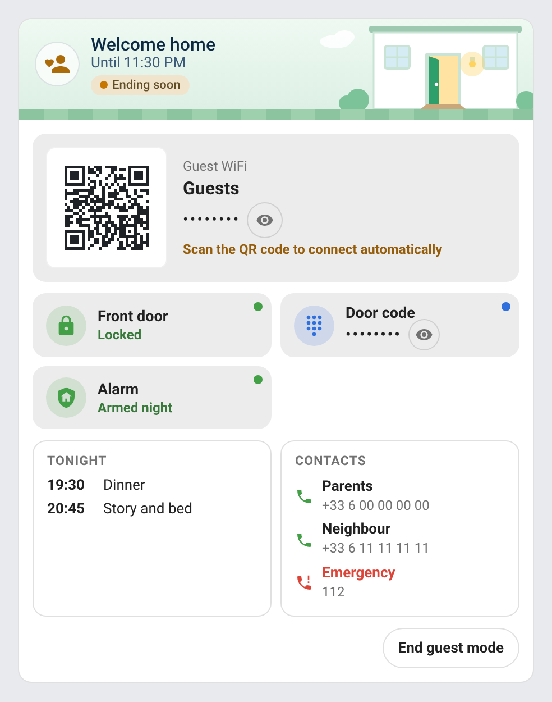 | 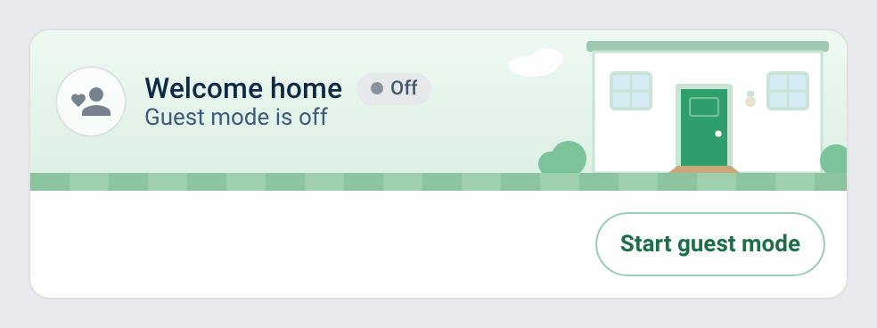 |
| 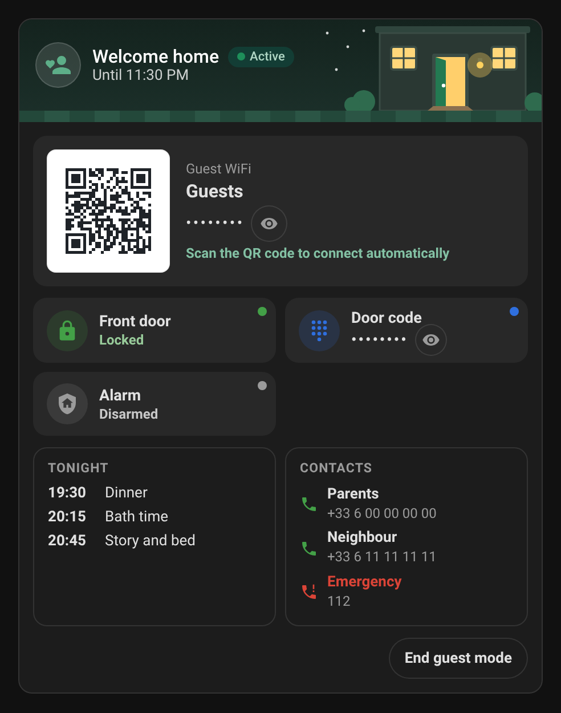 |  | 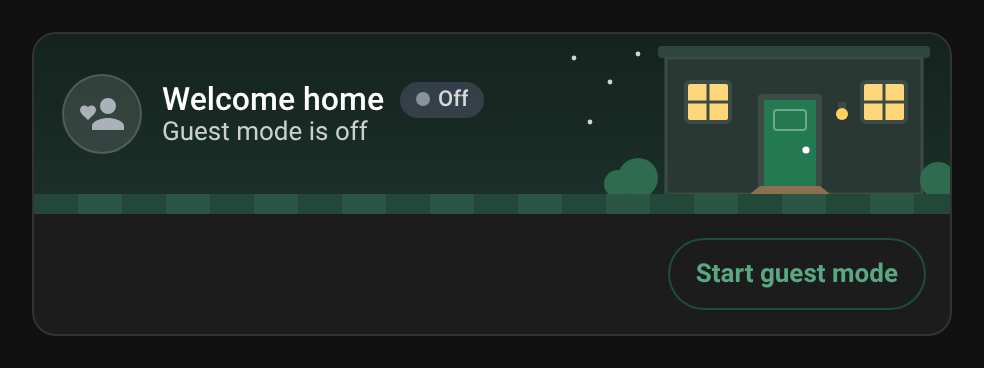 |

| Password shown | The Wi-Fi alone (open network) | Narrow |
|---|---|---|
| 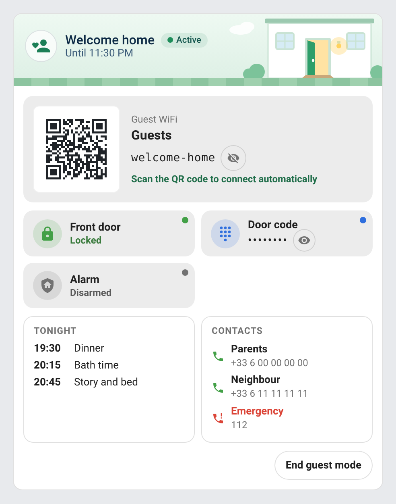 | 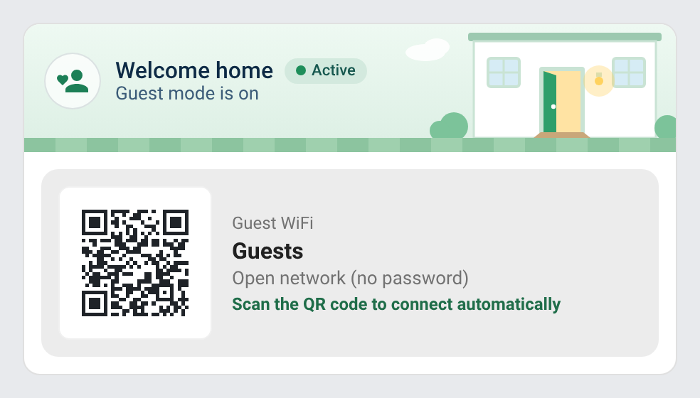 | 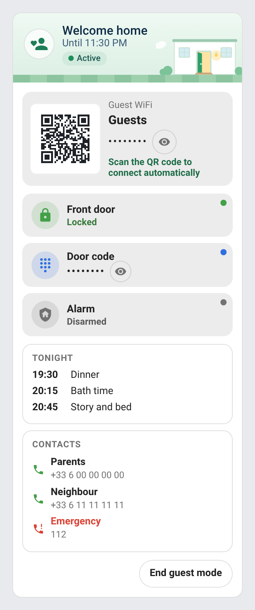 |
| 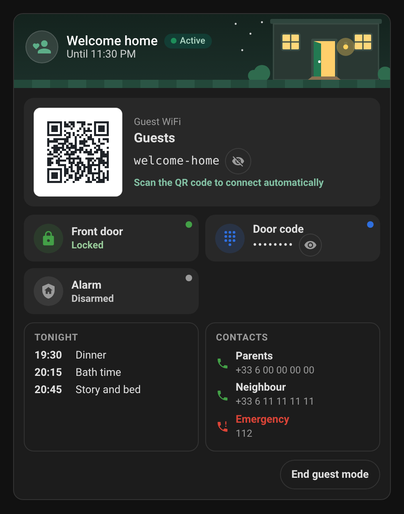 | 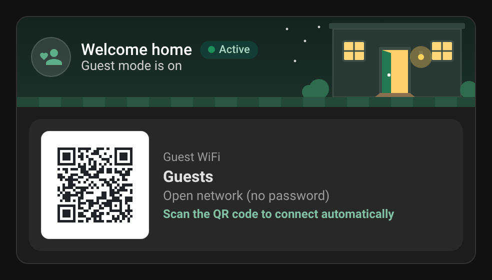 | 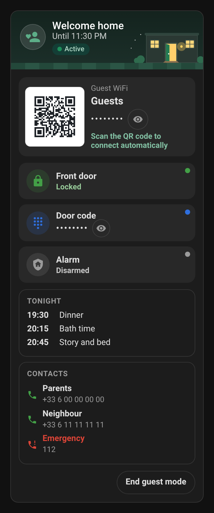 |

**Welcome animation**: guest mode on, the door is open, the porch light breathes and the bushes sway; by night the stars twinkle (still with `animations: false`, or when the system asks for reduced motion).

| Light | Dark |
|---|---|
| 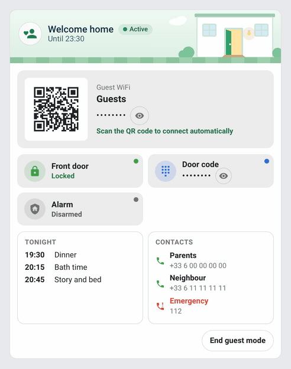 | 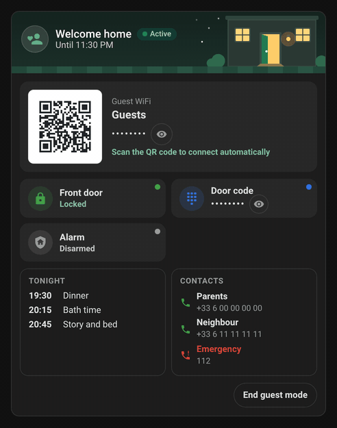 |

### Guest mini

| Guest mode on | Guest mode off | Zoomed in |
|---|---|---|
| 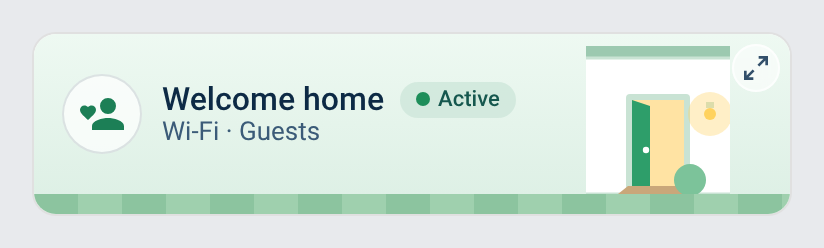 | 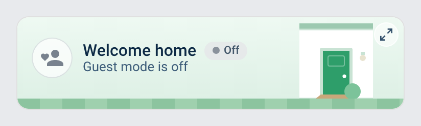 | 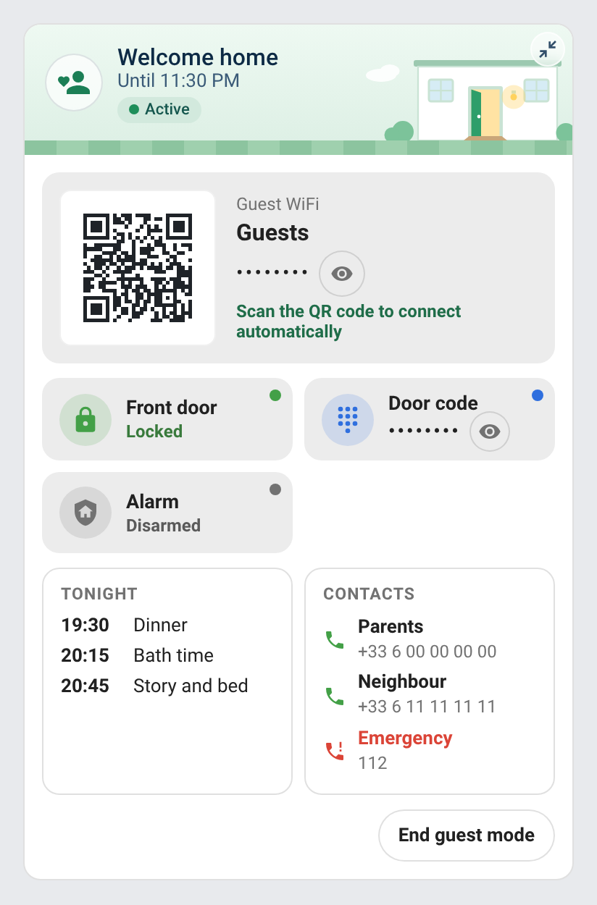 |
| 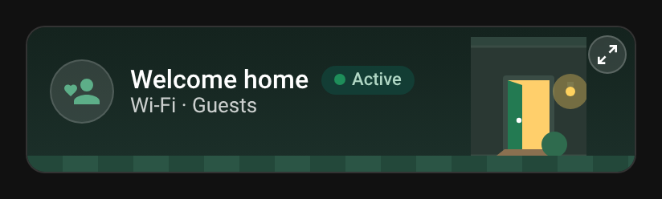 | 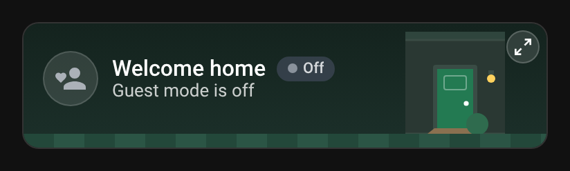 | 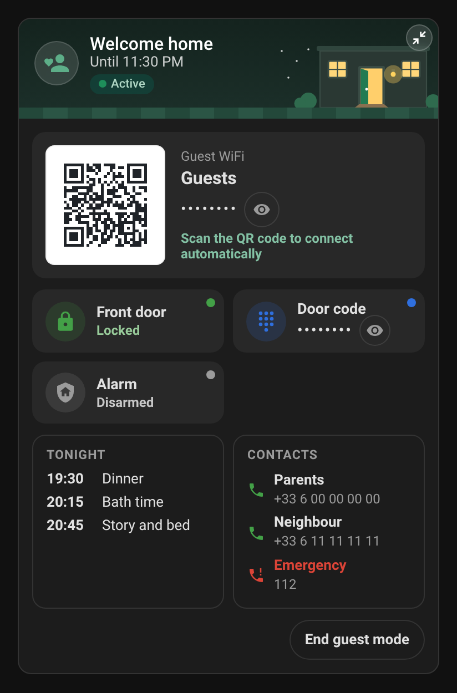 |

## How it works

- **QR code**: the standard `WIFI:` text phones read (its reserved characters escaped), drawn by the card at the smallest QR version that holds it (error correction M, with the quiet zone); rebuilt only when the network changes
- **Guest mode**: on when `entity` is `on` (always on without one); *Ending soon* in its last 30 minutes before `end`; the button calls `homeassistant.turn_off` / `turn_on` on `entity`
- **End time**: `HH:MM` is tonight's (a time already passed by more than 6 hours is the next one, so `01:00` seen at 19:00 is after midnight); a time-only `input_datetime` the same; a date / time entity as it is
- **Tonight**: the `tonight` list and the calendar's timed events that have not ended, from now to midnight (or the end of guest mode when later), in time order; the calendar is asked again every 15 minutes and at each new day
- **Lock and alarm**: their state as Home Assistant writes it (translated); a lock locked is green, unlocked or open blue, moving amber, jammed red; an alarm armed is green, disarmed grey, arming amber, triggered red
- **Secrets**: never in the page until shown; masked again after 30 seconds, and when the card leaves the page (another view, a conditional card hidden), when the full screen QR code closes too
- **Refresh**: the card redraws on each change of its entities

## Development

```bash
npm install
npm run build        # stamps the version of package.json into dist/ha-guest-card.js
npm run check        # builds and checks the bundle (run in CI)
npm test             # unit tests
npm run screenshots  # renders the cards with mock data into screenshots/ (and the GIFs, needs ffmpeg)
```

The source is split into ES modules under `src/shared/` (entry `src/shared/index.js`) and the card in `src/guest-card.js`; `npm run build` assembles them (`scripts/bundle.mjs`) into the single file the Marketplace serves.

`dist/` is not committed: `npm run build` creates it locally, CI builds it on every push, and the release workflow attaches the built files to the release, which is where the Marketplace installs them from.

### Releasing

1. Bump `version` in `package.json` (and `package-lock.json` with `npm install`)
2. Add a `## <version>` section at the top of [CHANGELOG.md](https://github.com/juju35/ha-guest-card/blob/main/CHANGELOG.md)
3. Merge a `feat` or `fix` pull request into `main`: the **Release** workflow builds the card, creates the tag and the GitHub release with the changelog sections as notes, and attaches `ha-guest-card.js` and its translation files

## Translations

The card auto-detects the language from your Home Assistant settings. Currently supported:

| Language | Code |
|---|---|
| English | `en` |
| Français | `fr` |
| Deutsch | `de` |
| Español | `es` |
| Српски | `sr` |
| Srpski (latinica) | `sr-Latn` |
| Italiano | `it` |
| Nederlands | `nl` |
| Português (Portugal) | `pt` |
| Polski | `pl` |
| Română | `ro` |
| Dansk | `da` |
| Svenska | `sv` |
| Български | `bg` |
| Русский | `ru` |
| Українська | `uk` |
| Magyar | `hu` |
| Slovenčina | `sk` |
| Čeština | `cs` |
| Slovenščina | `sl` |
| Latviešu | `lv` |
| Ελληνικά | `el` |

Contributions for additional languages are welcome!

## License

[MIT](https://github.com/juju35/ha-guest-card/blob/main/LICENSE)

## Support

If you find this project useful, you can support its development:

<a href="https://buymeacoffee.com/julienstep9"></a>
